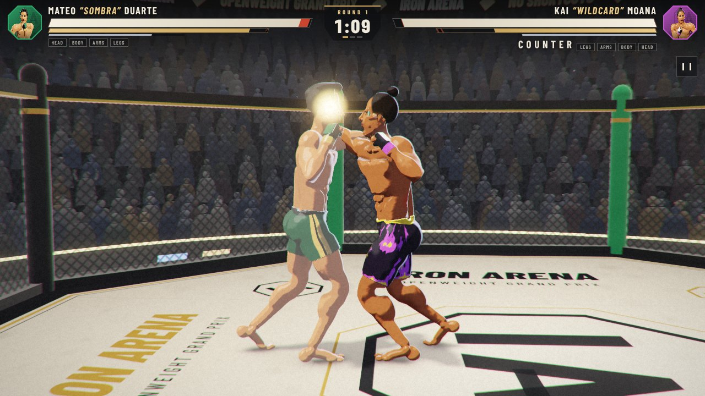
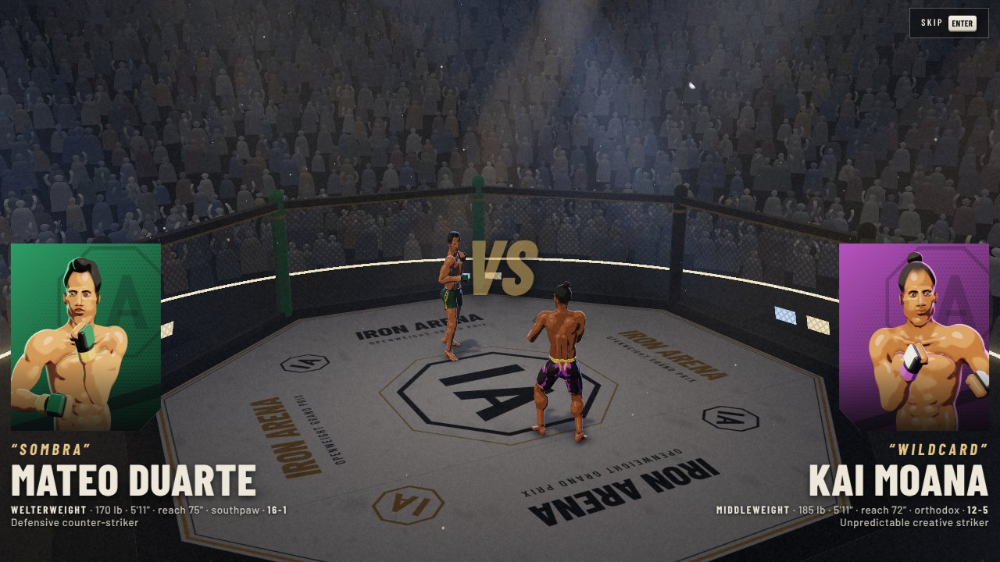
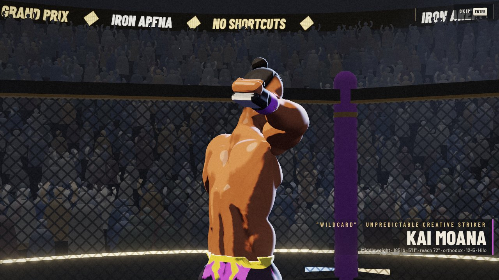
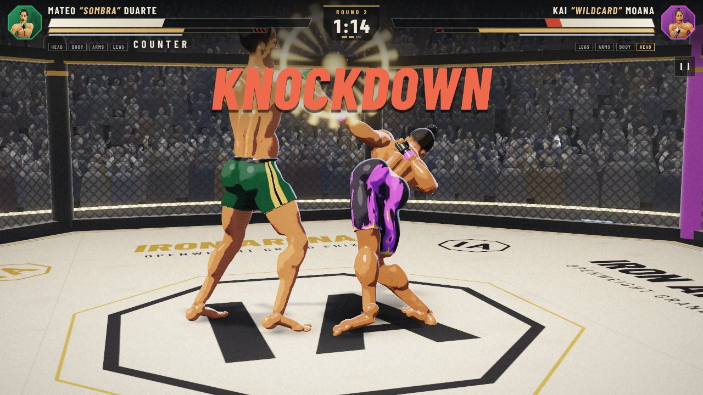
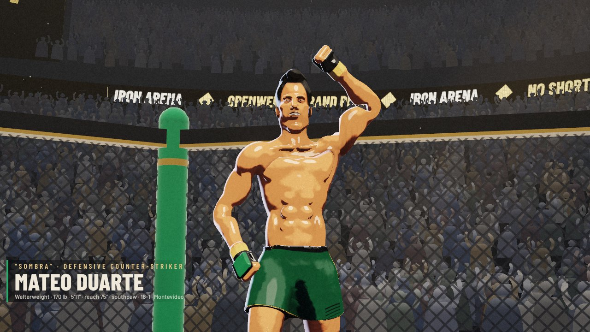
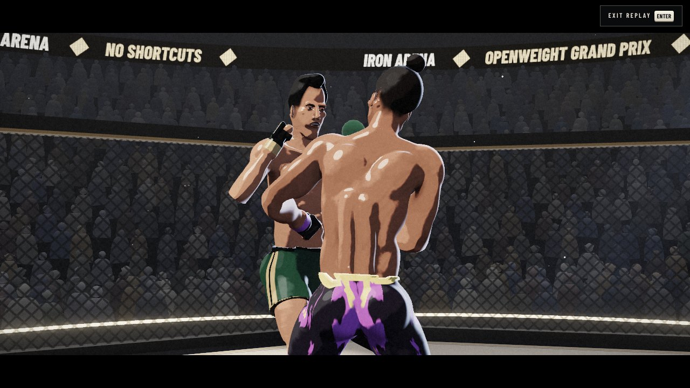
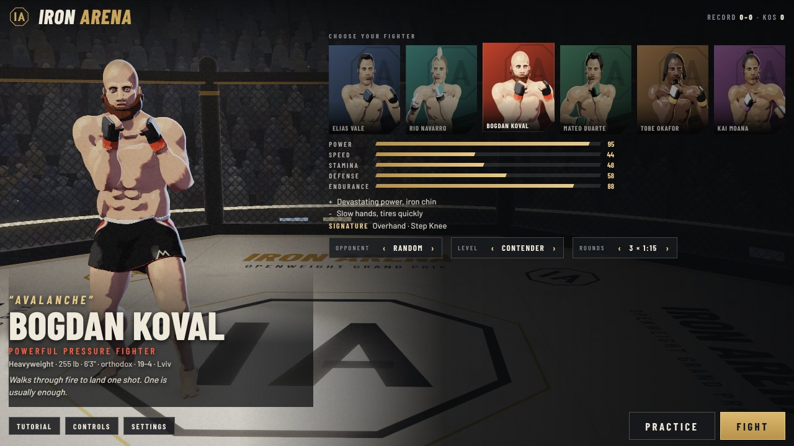

# IRON ARENA

An original, browser-based MMA striking game in a single HTML file. Illustrated fighters sculpted at load time, a control-rig animation system with IK, a physics-assisted knockout, recorded replays, a nine-step playable tutorial, six fictional fighters and a full fight card presentation.

**To play:** open [`iron_arena.html`](iron_arena.html) in a current desktop or mobile browser. It needs an internet connection the first time (three.js r160 is loaded from a CDN, with two fallbacks; the Barlow fonts are optional). No install, no build step, no accounts.

| | | |
|---|---|---|
|  |  |  |
|  |  |  |

Everything in the game is original: names, likenesses, moves-as-game-actions, art, interface, sound and code. No third-party assets are used; every mesh, texture and sound is generated in the browser.

## Controls

One strike grid on every device: **four columns** (quick punch, power punch, quick kick, power kick) × **three heights**.

### Keyboard (rebindable in Pause → Controls)

| | Quick punch | Power punch | Quick kick | Power kick |
|---|---|---|---|---|
| **High** | `U` lead hook | `I` uppercut | `O` high kick | `P` head kick |
| **Mid** | `J` jab | `K` cross | `L` teep | `;` body kick |
| **Low** | `M` body jab | `,` body cross | `.` calf kick | `/` thigh kick |

| Action | Key |
|---|---|
| Move | `W` `A` `S` `D` or arrow keys (relative to the screen) |
| Guard | hold `Space` — add `W` / `S` for a high / low guard |
| Evade | tap `Shift` + direction — back: sway · sideways: slip · toward: duck |
| Signature strikes | `H` and `N`, or both punch keys / both kick keys of the middle row together |
| Pause, move list, settings | `Esc` |
| Skip tutorial / skip intro / exit replay | `T` / `Enter` / `Enter` |
| Mouse | left button quick punch, right button power punch |

Bindings are stored by physical key position, so the grid sits in the same place on non-US layouts.

### Touch

Drag anywhere on the left to move. On the right: **JAB**, **POWER** (punch), **KICK**, **POWER** (kick) — **tap** for the middle height, **flick up** for high, **flick down** for low. **GUARD** is a hold button (stick up / down sets a high / low guard), **EVADE** is a tap with a stick direction, and the two **★** buttons throw signature strikes. Landscape puts the controls in the corners; portrait gives the fight the upper part of the screen and a dedicated control deck below.

### Gamepad (standard mapping)

Left stick / d-pad move · `X` `Y` quick / power punch · `A` `B` quick / power kick · hold `RT` for high, `LT` for low · `RB` guard · `LB` evade · `X+Y` / `A+B` signature · `Start` pause.

### How the fighting works, briefly

- **Chain different limbs** to cancel a strike's recovery into the next one. Pressing the same button again throws its follow-up (hook → uppercut, cross → rear hook). Finishing one of your fighter's **named combinations** adds damage.
- **Guard** blocks fully only at the right height: a high guard stops head strikes and leaves the body open, a low guard stops body strikes and checks leg kicks, the neutral guard partly covers both. Blocking drains the guard meter; empty it and the guard breaks. Raising the guard just before impact is a **perfect block**.
- **Evading** is typed: slips beat straight strikes, ducks beat high strikes (but eat uppercuts and knees), sways beat punches to the head. A clean evade opens a **counter window** — faster, harder next strike.
- **Stamina** (gold bar) pays for everything. The striped part is long-term fatigue that only comes back between rounds. Low stamina means slower, weaker strikes.
- **Condition** is tracked for head, body, arms and legs. Leg damage slows you, arm damage slows punch recovery and weakens the guard, body damage cuts stamina, head damage lowers the knockdown threshold.

## What is implemented

**Characters and rendering**
- Fighters are *sculpted*, not assembled from primitives: each body is a smooth-blended signed-distance field of muscle groups, meshed with surface nets in Web Workers at load, auto-skinned, with baked occlusion and crease data. Six different builds, heads, hair and beards.
- Illustrated material: three painted tones with brush-wobbled edges, hatching in shadow, ink wash in creases, rim light, sweat highlights, inked outlines.
- Painted faces (2D canvas projected onto the sculpted head) with blinking and 13 expressions that change in combat; swelling and small stylised marks as damage accumulates.
- Non-graphic damage feedback: flush and bruising per body region, impact marks where strikes landed, sweat build-up, canvas dirt after knockdowns.
- Arena: octagon with painted canvas, chain-link that fades on the camera side, padded posts in corner colours, light rig with beams, three-tier animated crowd that reacts to the action, camera flashes, LED ribbon, live hanging screens, haze and dust.
- HDR pipeline with MSAA, bloom, grade, vignette and grain; impact smear and flash; contact shadows; adaptive resolution; three quality tiers.

**Animation**
- Control rig with two-bone IK: fists land where they are aimed and feet stay planted.
- Procedural footwork: feet plant in world space and step to catch the body (no skating); per-fighter stance, bounce, sway and step rhythm.
- 27 strike clips with anticipation, contact, follow-through and recovery, blended in from whatever the body was doing; spins rotate through the root.
- Evasions, direction-sensitive hit reactions driven by springs, staggers, fatigue posture and breathing, two get-ups, six introductions, four celebrations.

**Combat**
- 27 moves with startup / active / recovery, stamina cost, reach, damage, daze, push and commitment; per-fighter move grids and signature strikes.
- Buffered input, chains, follow-ups, named combinations, counter-hits, trades.
- Guard heights, guard meter and guard break, perfect blocks, leg-kick checks, typed evasions with counter windows.
- Stamina with long-term fatigue; four-region condition with gameplay effects; knockdowns, get-ups, KO / TKO, three-knockdown rule, judges' scoring.
- Five ratings per fighter (power, speed, stamina, defense, endurance) that each drive real values, plus reach from actual limb length.
- Opponent AI with three levels and a personality per fighter: reaction delay, level reads, evasion, range management, combination choice, punishing whiffs, resting when tired.

**Impact and physics**
- Strike contact measured on the posed skeletons (shoulder / hip to target, limb length), hit-stop, directional camera knock.
- Physics-assisted falls: an 18-joint constrained particle body that starts from the animated pose with its momentum, holds for a beat and then gives way; mapped back to the skeleton; blended into an authored get-up.

**Presentation**
- No menu on start: the first session opens in a nine-step playable tutorial (skippable at any time), then goes straight into the first fight. Returning players land in a playable warm-up.
- Fight card: versus card with rendered portraits, per-fighter entrance shots, round cards, knockdown and knockout sequences, winner shot, results with statistics.
- **Replay** of the decisive moment from recorded skeleton frames, two passes from different cameras in slow motion, with exit.
- Fighter select with live 3D preview, practice mode (partner behaviour, strike data read-out, infinite stamina toggle), rematch, record and two unlockable fighters.
- Procedural audio: layered impacts, whooshes, blocks, footsteps, breathing, a crowd bed that follows the fight, crowd reactions, bell and stings. Volume controls.

## The fighters

| Fighter | Archetype | Stance | Pow | Spd | Sta | Def | End | Signature |
|---|---|---|---|---|---|---|---|---|
| Elias "Blueprint" Vale | Technical all-rounder | Orthodox | 72 | 74 | 74 | 76 | 72 | Superman Punch · Question Mark Kick |
| Rio "Flicker" Navarro | Fast evasive striker | Southpaw | 62 | 96 | 84 | 72 | 62 | Flicker Blitz · Flying Knee |
| Bogdan "Avalanche" Koval | Powerful pressure fighter | Orthodox | 95 | 44 | 48 | 58 | 88 | Overhand · Step Knee |
| Mateo "Sombra" Duarte | Defensive counter-striker | Southpaw | 72 | 80 | 74 | 95 | 68 | Pull Counter · Side Kick |
| Tobe "Engine" Okafor *(2 wins)* | Endurance specialist | Orthodox | 64 | 64 | 98 | 64 | 78 | Shovel Hook · Switch Kick |
| Kai "Wildcard" Moana *(4 wins)* | Unpredictable creative striker | Orthodox | 88 | 86 | 72 | 64 | 76 | Spinning Backfist · Spinning Back Kick |

## Known limitations

- **Striking only.** There is no clinch, takedown or ground game, and no referee character; fights end by knockout, technical knockout or decision.
- **Frame rate on real hardware is unverified.** Development and testing ran on a software rasterizer. The high tier draws about 1.1 M triangles in ~135 draw calls, medium 0.74 M, low 0.51 M; the game lowers render resolution automatically if the frame rate drops, but older phones may still struggle.
- **Not tested on real phones, Safari or Firefox**, and gamepad support was written to the standard mapping but not exercised with a physical pad.
- **Sound was verified by measurement, not by ear** (the output level is non-zero and events fire without errors). The mix has not been tuned on speakers.
- Faces are painted onto the head, so the mouth does not open in the geometry; expressions read well at fight distance and less well in extreme close-up.
- Hands are always gloved fists; shorts are skinned and do not simulate cloth.
- Arms and legs can pass through the other fighter's body during some exchanges; contact is resolved at the strike point only.
- Get-ups blend out of the ragdoll pose and can look abrupt from unusual positions (for example against the fence).
- The roster is roughly, not perfectly, balanced in AI-vs-AI simulation (see below), and the samples are small. Every simulated fight ended in a finish — AI opponents trade more than a careful human would, so decisions mostly happen in human play.
- No online play, no local two-player mode, no career mode.

## Testing report

All testing was automated in headless Chromium (Playwright) with software WebGL2, driving the real page — the shipped `iron_arena.html` opened from `file://`, with only the three.js CDN request served from a local copy because the sandbox blocks CDNs. Screenshots were captured at each stage and inspected.

**Genuinely tested**

- **Whole flow** (`tools/smoke_test.cjs`, 54 checks, all passing): boot without a menu → tutorial with real key presses → skip → first-fight introduction → round start → direct key control (cross, head kick, guard, evade) → fight to a finish → results → replay (two camera passes, exit) → rematch → judges' decision when the clock runs out → fighter select → practice with strike read-out → pause, move list, key rebinding and reset, settings → returning-player boot. No uncaught errors.
- **Tutorial completed end to end** by a scripted player using keyboard events: all nine steps including blocking three strikes, evading two on timing, a three-hit combination and the stamina exercise.
- **Every move** (27) thrown at four distances: each connects inside its range and whiffs outside it.
- **Defensive rules**, one scripted exchange each: high / neutral / low guard against head, body and leg strikes; perfect block; leg-kick check; slip, sway and duck against straight, round and rising strikes; late evade is punished; counter-hit; simultaneous trade.
- **Stamina**: strikes drain it, it recovers gradually, long-term fatigue accumulates.
- **Knockdowns, get-ups, knockouts and ragdoll** occurred in hundreds of simulated fights without instability; get-up and fall poses were inspected in screenshots and filmstrips.
- **Fighter differences**: more than 300 full AI-vs-AI fights across all 15 pairings were simulated headlessly and the ratings and AI were tuned from the results. In the last full batch (6 fights per pairing) most pairings finished 4–2 or 3–3, fights averaged 75–150 s with 1–2.5 knockdowns; details below.
- **Touch** with real touch points on five viewport sizes (568×320 to 1024×768, landscape and portrait): joystick, tap, flick up / down, guard hold; an automated audit confirms no HUD element overlaps another or leaves the screen in the tutorial and in a fight.
- **Audio** graph starts after the first gesture and produces non-zero output.
- **Animation** filmstrips reviewed for every strike, evasion, get-up and signature move; fighter models and portraits reviewed for all six.
- **CPU cost**: about 0.6 ms per frame for simulation, AI, IK, animation and audio scheduling.

**Not tested** — real GPU frame rate; physical phones and tablets; Safari and Firefox; a physical gamepad; how the audio sounds; long play sessions by a human for feel and difficulty.

### AI-vs-AI balance, final batch

Both corners driven by the Contender-level AI, three rounds, 6 fights per pairing (90 fights):

| | Wins | Losses |
|---|---|---|
| Okafor | 22 | 8 |
| Vale | 17 | 13 |
| Moana | 16 | 14 |
| Navarro | 13 | 17 |
| Koval | 12 | 18 |
| Duarte | 10 | 20 |

Okafor and Duarte were then adjusted (Okafor down, Duarte up) and re-run on six pairings only (36 fights): Okafor 14–10, Duarte 13–5 across theirs. That last adjustment has not been re-verified across the full grid, and with 6 fights per pairing the noise is large — treat these as a sanity check that no fighter is unusable or unbeatable, not as proof of fine balance. Human-vs-AI difficulty has not been play-tested by a person.

## Project layout

`iron_arena.html` is the whole game and the only file you need. `src/` holds the same code split by system (core, sculpt kernel, anatomy, roster, shaders, renderer, arena, fighter model, rig, clips, animator, ragdoll, combat, AI, camera/effects, audio, input, replay, match, UI, tutorial, game flow) and `node tools/build.mjs` concatenates it back into the HTML — a 20-line script with no dependencies, there for readability rather than necessity.

`tools/smoke_test.cjs` is the optional end-to-end test (`npm i -g playwright`, then `node tools/smoke_test.cjs`).

Debug views for development: `iron_arena.html?view=model&f=koval`, `?view=clip`, `?view=arena`. Useful flags: `?q=low|medium|high`, `?tutorial` (replay the tutorial on boot), `?unlock`.
